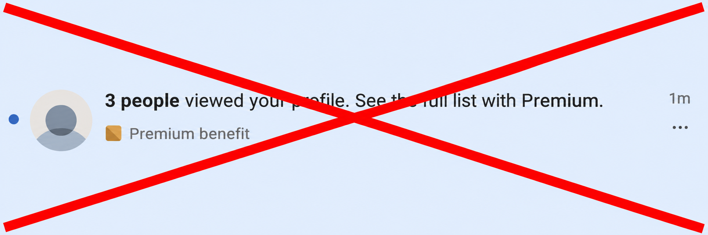

# LinkedOut



*Thrilled to announce some peace and quiet.*

A local Chrome and Safari WebExtension that hides LinkedIn Premium sales notifications, including “3 people viewed your profile. See the full list with Premium.”

## Install in Chrome

Download or clone this repository. The built extension is included in `dist/chrome` — no npm install is needed to use it.

1. Open `chrome://extensions` and turn on **Developer mode**.
2. Choose **Load unpacked** and select this project's `dist/chrome` folder.
3. Reload any existing LinkedIn tabs. Pin LinkedOut if you want quick access to its popup.
4. Visit https://www.linkedin.com/notifications/. Matching sales notifications are hidden automatically.

When updating an unpacked installation, click LinkedOut’s reload icon on `chrome://extensions`, then reload LinkedIn. Version 0.1.2 fixes SVG menu icons being mistaken for avatars and includes LinkedIn’s duplicated full-row link in the hidden notification. The regression suite includes the actual notification markup supplied by the user.

The popup lets you pause filtering and see how many notifications are currently hidden in your active tab. Pausing restores them immediately.

## Install in Safari on macOS

The shared Safari WebExtension is ready in `dist/safari`. To package it as a macOS Safari extension, run from a normal macOS Terminal with Xcode installed:

```sh
sh scripts/package-safari.sh
open safari/LinkedOut/LinkedOut.xcodeproj
```

Choose a signing team in Xcode if required, select the macOS app scheme, and build/run it. Enable LinkedOut in Safari → Settings → Extensions, grant it website access to `www.linkedin.com`, and reload LinkedIn. For an unsigned local development build, enable Safari's developer features and **Allow Unsigned Extensions** if required. Safari may require enabling unsigned extensions again after restarting.

Apple's current packaging command is `safari-web-extension-packager`; the script also supports Xcode versions that expose the older `safari-web-extension-converter` name. Xcode generates the app container around the supplied, already implemented WebExtension. App Store distribution requires your Apple signing and distribution setup.

The managed environment used to create this project could not run the packager successfully: it returned “requires access to the supplied path” and “Unable to parse manifest.json.” Both manifest files parse as JSON and all referenced files exist, but native Safari packaging and installation still need to be completed locally. No signed Safari app is included.

## Desktop push notifications

Hiding a notification in the page cannot stop the same notification arriving from LinkedIn's server through its service worker. LinkedOut does not claim to selectively intercept those pushes.

- **Chrome:** click **Block all LinkedIn desktop alerts** in the popup. Grant the optional site-settings permission. This blocks desktop notifications from LinkedIn, including messages and job alerts. **Remove LinkedOut’s desktop block** removes only this extension's rule and returns control to your previous browser settings; it never forces notifications to be allowed.
- **Safari:** open Safari → Settings → Websites → Notifications and set `linkedin.com` to **Deny**. The popup includes these directions.
- To keep useful desktop alerts, use the popup's **LinkedIn notification settings** link and disable the promotional categories LinkedIn offers for your account.

This does not affect LinkedIn's mobile app alerts, emails, server-side unread counts, browser title counts, or notifications already delivered to your operating system. The filter hides matching notification rows and promotional toasts; it does not remove every Premium link, banner or navigation item across LinkedIn.

## Privacy and matching

No account login, analytics, remote code, telemetry, or server. Settings stay in local browser storage. The extension reads only the loaded LinkedIn page and does not click, dismiss, mark as read, or delete notifications on your account.

Rules target explicit English Premium sales language and, for short trial CTAs, LinkedIn sales links. A plain mention of “Premium” does not match. Feed posts and messages are outside the page filter's scope. Because LinkedIn controls its markup and copy, new variants or other languages may need rules added in `extension/rules.js` and selectors updated in `extension/content.js`. Text-based matching may occasionally misclassify quoted sales copy inside a notification. Pause filtering to inspect any hidden items.

## Build your own with a prompt

To build an independent version, copy this prompt into your coding assistant. Review the generated source and permissions before loading it in your browser. You don't need to install LinkedOut or use its code.

```text
Build a small, local browser extension for Chrome and Safari that hides
LinkedIn Premium upsell notifications. Generate all source files, tests,
and installation instructions in a new project I can inspect myself.

Behavior:
- On https://www.linkedin.com/notifications/, hide individual promotional
  notification rows such as “3 people viewed your profile. See the full
  list with Premium.” and “Premium benefit”. Also hide Premium sales toasts.
- Match explicit sales copy such as “Try Premium”, “Upgrade to Premium”,
  and “See the full list with Premium”. Preserve ordinary notifications,
  messages, job alerts, feed posts, and mentions of Premium membership.
- Handle dynamically inserted and recycled rows, infinite scrolling,
  and LinkedIn's client-side navigation with a debounced MutationObserver.
- Avoid depending on generated CSS class names. Handle text split across
  spans, SVG profile avatars, and nested SVG menu icons. A menu icon is
  not an avatar. Hide the entire matching row, including any covering link
  with duplicate accessible text, without hiding neighboring rows or lists.
- Include a popup with a persistent on/off switch and the current hidden
  count. Turning filtering off must restore the hidden rows immediately.
- Hide locally only: do not click, delete, dismiss, mark notifications as
  read, or alter server-side unread counts or account preferences.

Desktop notifications:
- Be explicit that hiding page content does not selectively stop Premium
  pushes delivered by LinkedIn's service worker.
- In Chrome, offer a separate, opt-in control to block ALL LinkedIn desktop
  notifications, including messages and job alerts. Request contentSettings
  only when I click that control. Removing the block must clear only this
  extension's rule and restore the browser's existing policy, never force allow.
- In Safari, provide instructions for denying LinkedIn's website notification
  permission. Do not claim to control mobile app notifications or email.

Implementation and privacy:
- Use a shared Manifest V3 WebExtension with plain, readable JavaScript
  and separate Chrome/Safari packages. Restrict page access to
  https://www.linkedin.com/*. Use local storage for settings.
- Use browser-injected CSS for hiding rows so replacing the page's head
  doesn't remove the hiding rule. Preserve each element's original state.
- No backend, telemetry, analytics, credentials, remote scripts, external
  runtime assets, or unnecessary permissions. Explain each permission.
- Provide Chrome “Load unpacked” instructions and a Safari packaging script
  using Apple's Xcode tools. Distinguish source readiness from a signed app.

Verification:
- Test matching and nonmatching text, dynamic insertion, recycled rows,
  pause/restore, nested menus, SVG avatars, duplicate overlay links,
  permission denial, and restoring the previous desktop notification policy.
- If live markup differs, ask me for the notification row's outerHTML and
  turn it into a regression fixture. Do not declare success based only on
  invented HTML fixtures. Report exactly what was and wasn't verified.
```

## Development

Node.js 22+, npm, and ImageMagick (`magick`) are required to rebuild.

```sh
npm install
npm test
npm run build
npm run build:safari
```

The build compiles a bundled Tailwind 4 / daisyUI 5 popup stylesheet, generates icons from `assets/icon.svg`, and copies the shared sources into browser-specific folders. Only Chrome's manifest includes the optional `contentSettings` permission. No remotely hosted scripts or styles are used. To use a standalone Tailwind 4 binary, set `LINKEDOUT_TAILWIND` to its path.

```sh
npx playwright install chromium
node scripts/browser-smoke.cjs
```

The browser smoke test uses synthetic LinkedIn content and mocked extension APIs to exercise the popup and CSS visibility; it is not a live LinkedIn or installed-extension integration test.

## Validation in this environment

- 39 matching, DOM integration, popup behavior, and package regression tests passed.
- Chrome and Safari WebExtension builds generated successfully.
- The user confirmed Chrome filtering works on their live LinkedIn notifications page. Automated Chromium launch was blocked by the development sandbox, so automated installed-browser and visual QA remain pending.
- Safari native packaging was blocked as described above.

References: [Chrome site notification settings API](https://developer.chrome.com/docs/extensions/reference/api/contentSettings), [Apple Safari packaging](https://developer.apple.com/documentation/safariservices/packaging-a-web-extension-for-safari), [running a Safari extension](https://developer.apple.com/documentation/safariservices/running-your-safari-web-extension).
